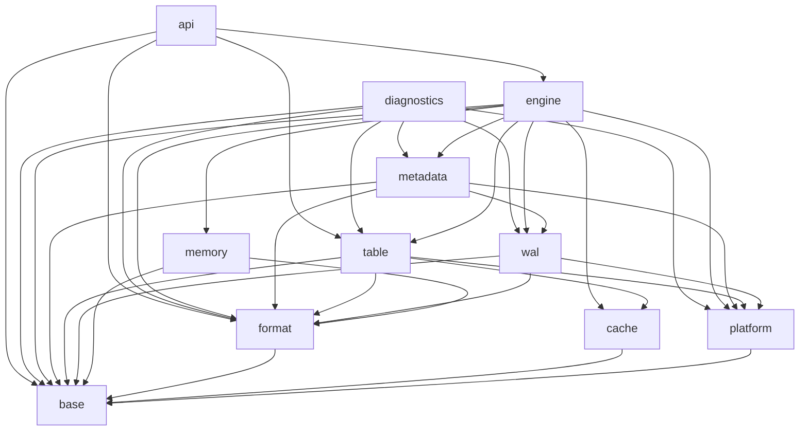

# Architecture

## Purpose

This document separates the original LevelDB implementation into logical
components, describes the important runtime flows, identifies dependency
problems that should not be reproduced, and defines the current architecture
of Modern LevelDB.

The reference source analyzed for this document is Google LevelDB
`7ee830d02b623e8ffe0b95d59a74db1e58da04c5`.

## Original LevelDB architecture

LevelDB is an embedded, single-process LSM tree. Its implementation is compact,
but physical source directories do not correspond cleanly to architectural
layers.

### Public API

The public headers under `include/leveldb` define:

- `DB`, snapshots, ranges, and maintenance operations.
- Read, write, and database options.
- `Slice`, `Status`, iterators, comparators, filters, caches, and write
  batches.
- The `Env` abstraction for files, clocks, logging, and background execution.
- Public table reader and writer types.

The API is stable but exposes manual lifetime management through raw owning
pointers. Core implementation headers also include public DB headers to obtain
types that are logically lower-level than the DB facade.

### Engine orchestration

`db/db_impl.cc` is the main coordinator. It owns or coordinates:

- The writer queue and write grouping.
- WAL creation, append, synchronization, and rotation.
- Mutable and immutable memtables.
- Snapshots and sequence-number assignment.
- Table cache and version metadata.
- Background flush and compaction scheduling.
- Database recovery, obsolete-file deletion, and shutdown.

This concentration makes behavior easy to trace, but it also combines policy,
concurrency, persistence, and resource ownership in one class.

### In-memory state

The mutable state consists of:

- An arena allocator in `util/arena.*`.
- A single-writer, concurrent-reader skip list in `db/skiplist.h`.
- A memtable in `db/memtable.*`.
- Internal keys containing a user key, sequence number, and value kind in
  `db/dbformat.*`.
- Encoded write batches in `db/write_batch.*`.

The active memtable accepts writes. Once it reaches the configured size it
becomes the single immutable memtable and is flushed to an L0 SSTable.

### WAL

`db/log_writer.*` and `db/log_reader.*` implement a block-fragmented log:

- Physical blocks are 32 KiB.
- Physical records have a checksum, length, and fragment kind.
- Logical records may span first, middle, and last fragments.
- Write batches are logical WAL records.

The WAL is used both for user writes and as the framing mechanism for MANIFEST
records.

### SSTables

The table subsystem consists of:

- Prefix-compressed data blocks with restart points.
- Index, metaindex, and filter blocks.
- Block handles and a fixed footer containing the LevelDB magic number.
- Optional Snappy or Zstd compression.
- CRC32C-protected block trailers.
- Immutable table readers and writers.
- Two-level and merging iterators.

Table construction depends on filesystem services, comparators, filters,
compression, checksums, and binary coding.

### Version metadata

`VersionSet` and `VersionEdit` maintain the logical LSM shape:

- Each `Version` is an immutable view of the files in every level.
- Live iterators retain old versions through reference counting.
- `VersionEdit` records file additions, deletions, sequence numbers, and
  compaction pointers.
- MANIFEST records persist version edits.
- `CURRENT` identifies the active MANIFEST.
- File numbers are allocated centrally.

The original implementation uses seven levels, fixed L0 file-count thresholds,
and approximately tenfold size growth between nonzero levels.

### Platform and utilities

The original `Env` interface combines several independent concerns:

- Sequential, random-access, and writable files.
- Filesystem namespace operations and locking.
- Clock and sleep operations.
- Background task scheduling and thread creation.
- Logging and test-directory selection.

`port` supplies mutexes, condition variables, compression adapters, endian
details, and thread-safety annotations.

## Runtime flows

### Write path

1. A writer joins the DB writer queue.
2. The queue leader groups compatible batches.
3. The group receives a contiguous sequence-number range.
4. The encoded batch is appended to the WAL.
5. A synchronous write flushes the WAL to durable media.
6. The batch is inserted into the mutable memtable.
7. Waiting writers receive the shared result.
8. A full memtable rotates to immutable state and schedules a flush.

The WAL append must precede memtable visibility. A failed synchronous flush
puts the original implementation into a persistent background-error state
because durability is no longer knowable.

### Read path

1. The read chooses an explicit snapshot sequence or the latest sequence.
2. An internal lookup key combines the user key and snapshot sequence.
3. The mutable memtable is searched.
4. The immutable memtable is searched.
5. The current `Version` searches L0 files from newest to oldest.
6. At most one candidate file is searched in each nonzero level.
7. Table cache, Bloom filters, indexes, block cache, and data blocks complete
   the lookup.

### Flush path

1. The immutable memtable is iterated in internal-key order.
2. A new SSTable is written and synchronized.
3. A `VersionEdit` adds the table to an appropriate level.
4. The edit is appended and synchronized through the MANIFEST.
5. The new version becomes current.
6. The old WAL and obsolete files become eligible for deletion.

The ordering between SST synchronization and MANIFEST installation is a
critical crash-consistency boundary.

### Recovery path

1. Acquire the database lock.
2. Read `CURRENT` and replay the selected MANIFEST.
3. Reconstruct the current version and global file-number state.
4. Discover relevant WAL files.
5. Replay valid write batches into a memtable.
6. Flush recovered state when required.
7. Create a new WAL and install any required metadata edit.
8. Delete files not referenced by live versions or active outputs.

### Compaction path

1. Score levels by L0 file count or nonzero-level byte usage.
2. Select one level and overlapping files in the next level.
3. Build a merged internal iterator over all inputs.
4. Drop shadowed values and obsolete tombstones when snapshots permit.
5. Split output SSTables by target size and grandparent overlap.
6. Synchronize output files.
7. Atomically install a `VersionEdit` deleting inputs and adding outputs.
8. Remove obsolete files after no live version references them.

## Dependency problems in the original layout

The file-level include graph is acyclic, but directory-level responsibilities
are not layered:

- `db` depends on `table` for table cache, iteration, building, and compaction.
- `table` depends on public API types and logical DB concepts.
- `db/dbformat.h` contains low-level internal-key encoding while including the
  top-level public `DB` and table-builder headers.
- `VersionSet` combines metadata modeling, MANIFEST persistence, compaction
  policy, table access, and iterator construction.
- `Env` combines filesystem, scheduling, time, and logging.
- Test-only helper dependencies make the `util` directory appear to depend on
  higher-level helpers.

These are not literal include cycles, but they prevent directory boundaries
from expressing a stable dependency direction.

## Current Modern LevelDB architecture

Modern LevelDB uses the following dependency layers. A module may depend on
modules in lower layers and on explicitly documented peers, but never on a
higher layer.

| Layer | Modules | Responsibility |
|---|---|---|
| 0 | `base` | Byte views, errors, results, coding, comparators, checksums, hashing |
| 1 | `cache`, `platform` | Generic sharded cache; filesystem, files, locking, clock, and executor |
| 2 | `format` | Internal keys, write-batch encoding, and WAL physical-record encoding |
| 3 | `wal`, `memory` | WAL stream I/O; arena, skip list, and memtable |
| 4 | `table` | Block/SST formats, filters, compression, SST reader/writer, block cache values |
| 5 | `metadata` | Filenames, immutable versions, version edits, version set and MANIFEST persistence |
| 6 | `engine` | Table cache, recovery, read/write paths, flush, compaction, snapshots, DB state |
| 7 | `api`, `diagnostics` | Public RAII facade; read-only storage-file diagnostics, native output, and tool support |

### Implemented module graph

Arrows point from a dependent module to a direct prerequisite.



### Required dependency rules

1. The public API is a facade and is never included by lower layers.
2. Format modules are pure encoders and decoders and perform no filesystem I/O.
3. Platform modules know nothing about LSM concepts.
4. Cache and platform primitives remain below formats/tables/engine policy.
5. Table modules depend on internal-key comparison through `format`, not on the
   DB engine.
6. Metadata modules describe immutable LSM state; orchestration remains in
   `engine`.
7. Background execution is injected through an interface and does not own DB
   policy.
8. Public and component ownership boundaries use values or RAII handles.
   Intrusive raw links and opaque identity handles may remain inside one
   documented owner; borrowed references must be explicit in API contracts.
9. Each persistent transition has a documented synchronization order and a
   fault-injection test.
10. Diagnostics depend on existing decoders, never on the engine or public API,
   and never mutate database files.

Fine-grained read instrumentation, its build target, and its conditional hooks
were retired under [ADR-0076](adr/0076-textbook-source-composition.md).
Ordinary benchmarks and CPU capture remain outside the core module graph.
The layer-seven storage-file `diagnostics` module remains supported.

## Current engine coordination

`DatabaseEngine` remains the single coordination root and the sole owner of the
database mutex. Algorithms continue to live in explicit recovery, lookup,
write-path, flush, compaction, and seek-statistics modules. The engine source is
partitioned by the consumer flow being followed:

| Source | Coordination responsibility |
|---|---|
| `engine/database.cc` | options, owned resources, open/close, and recovery installation |
| `engine/database_read.cc` | pinned point reads, iterators, snapshots, read sampling, and state inspection |
| `engine/database_write.cc` | writer entry, backpressure, WAL/MemTable rotation, commit, and forced flush entry |
| `engine/database_background.cc` | task scheduling, flush/compaction installation, reclamation, shutdown, and sticky failure |

Within those flows, obsolete-file reclamation separates retention (`KeepFile`),
locked collection/cache eviction (`CollectObsoleteFiles`), and unlocked deletion
(`RemoveObsoleteFiles`). Recovery separates fresh-WAL acquisition and its optional
durability barriers (`CreateRecoveryLog`) from replay and MANIFEST publication
(`RecoverDatabase`). These are responsibility boundaries, not new owners or
generic orchestration layers; see
[ADR-0077](adr/0077-bounded-orchestration-composition.md).

Two internal state owners make cross-field invariants explicit:

- `SnapshotRegistry` privately owns an intrusive registration list. Public
  snapshot handles retain an opaque node identity; registration, release, and
  oldest lookup are constant time under the database mutex.
- `WriteBufferState` owns the active WAL/mutable MemTable generation, immutable
  generation, published memory accounting, read-pin retention, and the atomic
  immutable-presence mirror. File creation, WAL close policy, scheduling, and
  VersionEdit installation remain DatabaseEngine responsibilities.

`EnginePolicy` groups the immutable write-buffer, target-file, WAL-creation, and
table-building settings retained after option sanitization. Resource
owner/borrower fields remain explicit. For fallback resources owned by the
database, reverse declaration order stops the owned executor first and destroys
users before their owned filesystem/cache/clock. Injected services remain
externally owned, are not stopped by DatabaseEngine, and must outlive it; the
engine only waits for its accepted background task to finish. Operational state
is released before the directory lock.

Small shared rules do not create additional state owners:
`api/database.cc` prepares read options independently of snapshot retention,
`engine/iterators` composes supplied file runs for both reads and compaction, and
DatabaseEngine shares the build-error/closing/edit-install decision while keeping
flush and compaction completion separate. See
[ADR-0075](adr/0075-shared-read-and-maintenance-rules.md) for the boundaries and
rejected broader extractions.

## Current source layout

```text
include/modern_leveldb/
  base/
  database_state.h
  db.h
  iterator.h
  options.h
  snapshot.h
  write_batch.h
src/
  api/
  base/
  cache/
  diagnostics/
  platform/
  format/
  wal/
  memory/
  table/
  metadata/
  engine/
tests/
  cmake/
  compatibility/
  crash/
  extended/
  model/
  support/
  tools/
  unit/
fuzz/
benchmarks/
cmake/
tools/
docs/
  adr/
  development/
  learning/
  reference/
```

The historical implementation and current remediation order are defined in
[`dependency-dag.md`](dependency-dag.md). That document owns delivery-node
dependencies; this document owns the current module graph.
